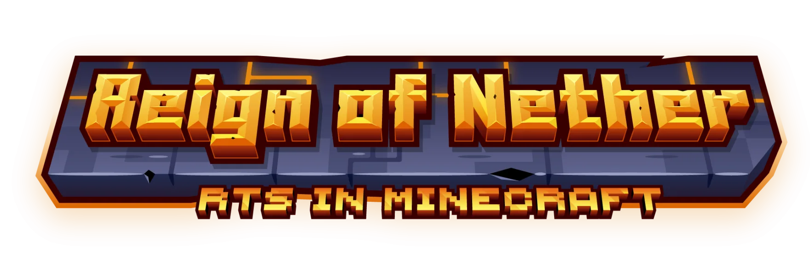
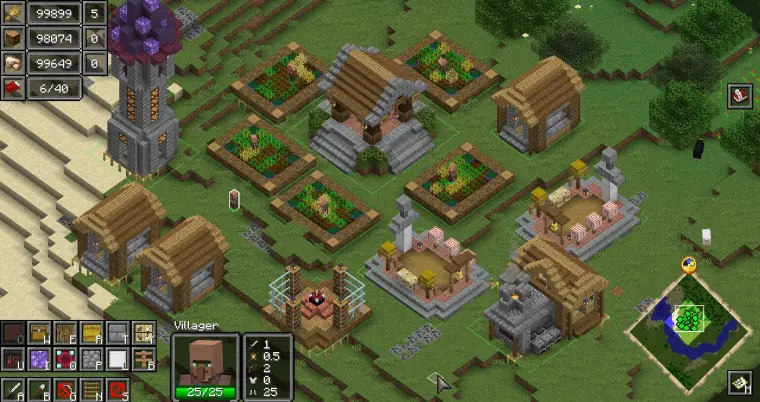
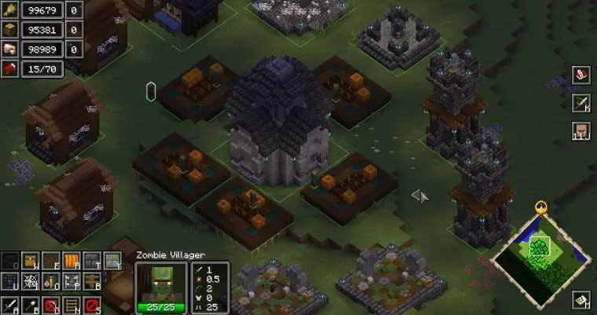
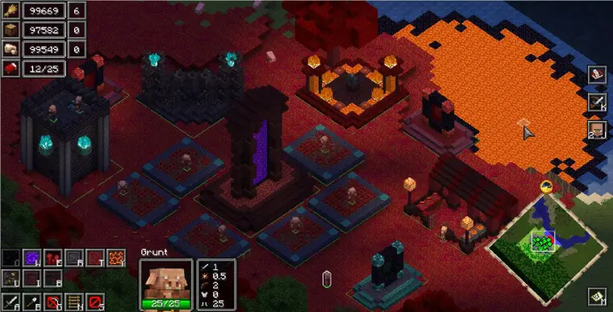
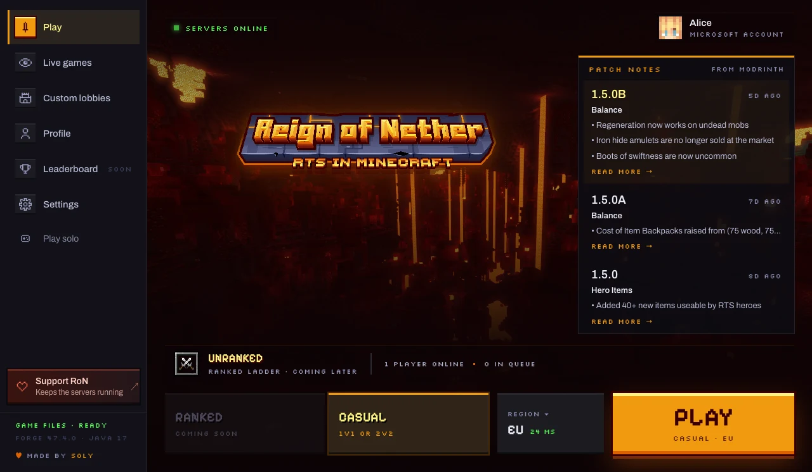
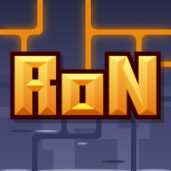

### RTS in Minecraft

Minecraft reimagined as a real-time strategy game. 
Build your base, gather resources, train your army and fight epic battles 
across three factions and four game modes.

**1M+ downloads** · Forge 1.20.1 · Client + Server · GPL-3.0

---

## Three factions

<table>
<tr>
<td width="33%" valign="top">

<h3> Villagers</h3>
The desperate alliance of villagers and illagers protecting their home. Warriors and spellcasters, backed by farmers, builders and craftsmen.
</td>
<td width="33%" valign="top">

<h3> Monsters</h3>
The wild creatures of the overworld. Raise the dead from graveyards, hatch spiders from nests. They shun sunlight, but once night falls, they should be feared.
</td>
<td width="33%" valign="top">

<h3> Piglins</h3>
Denizens of the nether, here to expand their empire. Wherever they build, grass becomes nylium and stone becomes netherrack.
</td>
</tr>
</table>

## Play online

The **RoN Launcher** signs you in with Microsoft and installs Java, Minecraft, Forge and the mods for you. Make a private lobby with friends, drop into a public one, or queue up and let the network find you a game. Spectate any match, and every official map is already loaded. Ranked queues are coming later.

**[Download the launcher](https://reignofnether.net/#launcher)**

## Projects

| | |
|---|---|
| [**reignofnether**](https://github.com/SoLegendary/reignofnether) | The mod itself, by SoLegendary |
| [**RoN-Wiki**](https://github.com/reignofnether/RoN-Wiki) | Community wiki, [wiki.reignofnether.net](https://wiki.reignofnether.net) |
| [**RoN-Multiplayer**](https://github.com/reignofnether/RoN-Multiplayer) | The original network: Velocity proxy, Paper lobby, Forge instances |
| **RoN-Website** | [reignofnether.net](https://reignofnether.net) and the network backend: matchmaking, lobbies, stats |
| **RoN-Launcher** | Desktop launcher for online play (Tauri + Svelte) |
| **RoN-Instance** | Forge mod that runs matches on the game servers |

## Get involved

Found a bug? [Open an issue](https://github.com/SoLegendary/reignofnether/issues). Want to talk strategy or help out? Join the [Discord](https://discord.gg/jJV5zK3hT9). Like the mod? [Buy SoLegendary a coffee](https://buymeacoffee.com/solegendary).

 
 
A mod by <b>SoLegendary</b> · Title &amp; icon by <b>omega9_6</b> 
Not an official Minecraft service. Not approved by or associated with Mojang or Microsoft.

